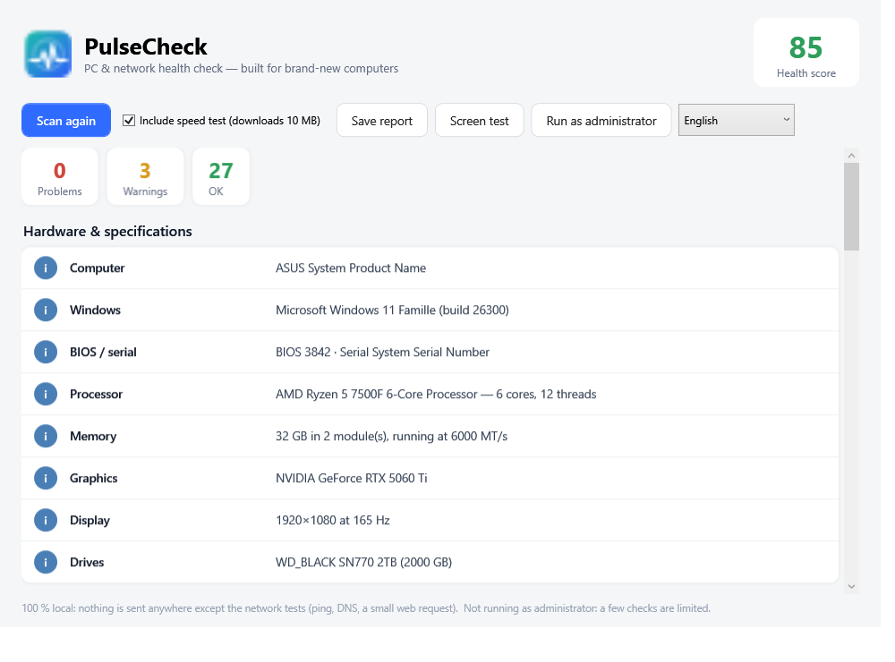
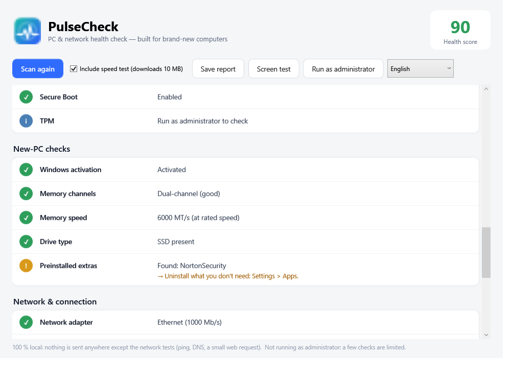

# PulseCheck

**A free PC & network health check, built for brand-new computers.**
Run it the day you unbox a new PC — or any time something feels slow or the connection drops.



## Why it exists

Buying a PC is a big purchase and it's hard to verify what you really got. PulseCheck answers the questions you'd otherwise have to Google:

| New-PC check | What it tells you |
|---|---|
| **Specifications** | CPU, memory, graphics, drives, screen resolution & refresh rate — compare with the box or the listing |
| **Memory speed & channels** | Whether your RAM runs at its rated speed (XMP/EXPO) and in dual-channel |
| **Battery wear** | A "new" laptop with a worn battery may be used or refurbished |
| **Windows activation** | Genuine and activated out of the box |
| **Preinstalled extras** | Trial antivirus and promotional apps you probably don't want |
| **Drive type & health** | SSD vs. mechanical drive, SMART health status |
| **Secure Boot & TPM** | Needed for Windows 11 and many anti-cheat systems |
| **Dead-pixel screen test** | Full-screen colours to spot dead or stuck pixels |

It also runs the everyday checks: CPU/RAM load, free disk space, drivers in error, startup programs, Defender & firewall status, Windows updates, crashes in the event log — and a **network diagnosis** that tells you *where* a connection problem is (your PC, the router, your provider, or DNS), with ping/jitter/packet loss, Wi-Fi signal, DNS speed, captive-portal detection and an optional speed test.

Every finding comes with a plain-language fix, a health score out of 100, and a shareable HTML report.



## Languages

English · Français · Español · Deutsch — detected automatically, switchable in the app. See [Adding a language](#adding-a-language).

## Download

Get `PulseCheck.exe` from the [latest release](../../releases/latest). No installation: double-click to run (Windows 10/11, 64-bit; .NET is bundled).

> **Windows SmartScreen:** the file is not code-signed yet, so Windows may show "Windows protected your PC". Click **More info → Run anyway**. You can verify the download against the SHA-256 hash published with each release, and you can read or build the source yourself.

For the most complete results, use the **Run as administrator** button (TPM and a few other checks need it).

## Privacy

PulseCheck is **100 % local**. It has no telemetry, no account and uploads nothing. The only network traffic is the connection test itself:

- ping to `1.1.1.1` and `8.8.8.8`, and to your router
- a DNS lookup and an HTTPS connection to `www.microsoft.com`
- one small request to `msftconnecttest.com` (captive-portal check)
- *optional*: a 10 MB download from `speed.cloudflare.com` for the speed test

Reports are saved only where you choose. PulseCheck is **read-only**: it never changes your system.

## Build from source

Requires the [.NET 8 SDK](https://dotnet.microsoft.com/download) on Windows.

```powershell
cd src
dotnet run -c Release
# single-file release build
dotnet publish -c Release -r win-x64 --self-contained true -p:PublishSingleFile=true `
  -p:IncludeNativeLibrariesForSelfExtract=true -p:EnableCompressionInSingleFile=true -o ../dist
```

Handy flags for testing: `--lang fr`, and `--screenshot out.png [--speed] [--scroll 800]` (runs a scan, saves an image of the window and exits).

## Adding a language

1. Copy `src/Lang/en.json` to `src/Lang/<code>.json` (e.g. `it.json`) and translate the values — keep the `{0}`, `{1}` placeholders.
2. Add the code and its display name to `Loc.Codes` / `Loc.Names` in `src/Models.cs`.
3. Open a pull request.

## Limitations

- Windows only. Some checks need administrator rights.
- Heuristics, not guarantees: battery wear, preinstalled-software detection and similar checks are indicators, not proof. The score is a rough guide.
- Not affiliated with Microsoft. "PC Health Check" is a separate Microsoft product.

## License

[MIT](LICENSE) — provided "as is", without warranty.
