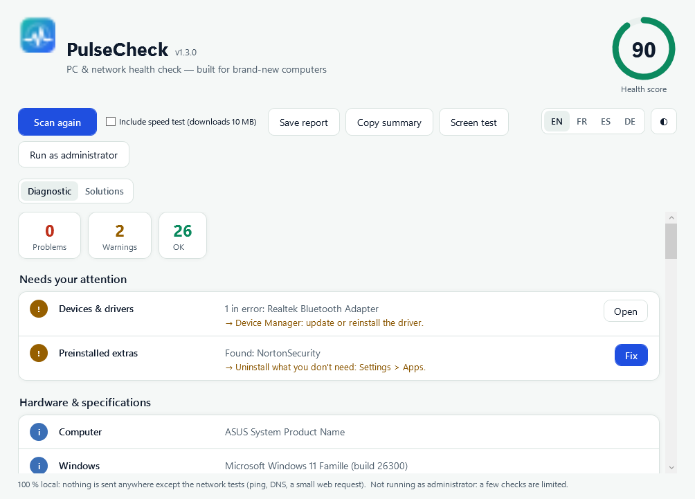
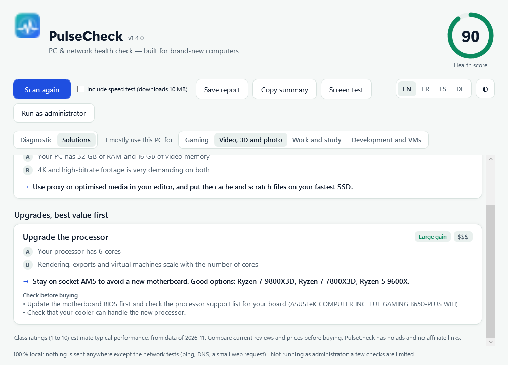
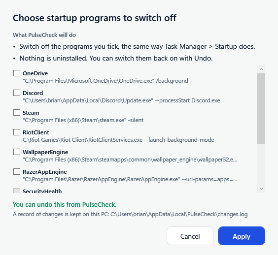

# PulseCheck

**Free, open-source PC and network health check for Windows, built for brand-new computers.**
Run it the day you unbox a PC, before the return window closes, or any time something feels slow or the connection drops.

**[Website and download](https://brillant000.github.io/PulseCheck/)** · [Latest release](https://github.com/Brillant000/PulseCheck/releases/latest) · [Privacy](https://brillant000.github.io/PulseCheck/privacy.html)



## What it checks

| Area | Checks |
|---|---|
| **Hardware** | CPU, memory, graphics, drives, display resolution and refresh rate, BIOS and serial number |
| **New-PC checks** | Windows activation, memory speed and channels (XMP/EXPO), battery wear, preinstalled extras, drive type and health |
| **Health and security** | CPU and memory load, free space, drive health, drivers in error, startup programs, Defender, firewall, Secure Boot, TPM, Windows updates, crashes and disk errors |
| **Network** | Router, ping, packet loss, jitter, Wi-Fi signal, DNS, web access, proxy and VPN, optional speed test, and a verdict on *where* the connection fails (PC, router, provider or DNS) |

### Solutions, not just problems

The **Solutions** tab compares your hardware with your screen and what you use the PC for (gaming, video/3D/photo, work and study, development) and explains what to change, in order of value:

- **Quick wins, free**: refresh rate stuck below the monitor's maximum, memory not at its rated speed (XMP/EXPO), old graphics driver, Game Mode, startup programs, power plan, low disk space. Each comes with the exact menu to open.
- **Settings for your hardware**: graphics presets matched to your card and display, the right upscaler (DLSS, FSR or XeSS) and a sensible frame cap.
- **Upgrades, explained "A + B"**: for example *A: your graphics card is class 4 of 10, B: your 1440p 144 Hz screen needs class 7 → pick a class 7 card*, with a cost range and what to check first (power supply, case, motherboard, RAM type). Laptops are never told to swap a soldered GPU or CPU.



Performance classes (1 to 10) are estimates kept in [`src/Data/hardware.json`](src/Data/hardware.json). PulseCheck has no ads and no affiliate links.

### One-click fixes

Next to a warning you may see **Fix**. It never runs by itself: PulseCheck first shows exactly what it will change, you confirm, and it is recorded in a local log (`%LOCALAPPDATA%\PulseCheck\changes.log`). Most fixes have **Undo**.

| Fix | What it changes | Undo |
|---|---|---|
| Game capture off, Game Mode on | Two or three Windows settings for your account | Yes |
| Proxy off | The Windows proxy switch for your account | Yes |
| Power saver to Balanced | The active power plan | Yes |
| Full refresh rate | The display mode, only to a mode Windows confirms is supported | Yes |
| Startup programs | Switches off the ones you tick, like Task Manager. Nothing is uninstalled | Yes |
| Restart | Restarts in 60 seconds | Cancel during the countdown |
| Clean temporary files | Deletes temp files older than one day. Skips files in use. Documents, downloads and the Recycle Bin are untouched | No |
| Remove preinstalled Store apps | Removes the Store apps you tick, for your account | No (reinstall from the Store) |



PulseCheck does not change your antivirus, firewall, drivers or BIOS, and never installs software. For findings it cannot fix safely, the button opens the right Windows page instead.

Every finding comes with a plain-language fix. You also get a health score out of 100, a "needs your attention" list, a one-click summary to copy, a shareable HTML report and a full-screen dead-pixel test.

English, Français, Español and Deutsch. Light and dark themes follow Windows.

## Download and verify

Download `PulseCheck.exe` from the [latest release](https://github.com/Brillant000/PulseCheck/releases/latest). Nothing to install (Windows 10/11, 64-bit, .NET is bundled).

The file is not code-signed yet, so Windows SmartScreen may show "Windows protected your PC": choose **More info, then Run anyway**.
Releases are built by GitHub Actions from this source. To check yours:

```powershell
Get-FileHash .\PulseCheck.exe -Algorithm SHA256      # compare with PulseCheck.exe.sha256
gh attestation verify .\PulseCheck.exe --repo Brillant000/PulseCheck
```

For the most complete results, use **Run as administrator** (the TPM check needs it).

## Privacy

100 % local. No account, no telemetry, nothing uploaded. Scanning is read-only. The only network traffic is the connection test: ping to your router, `1.1.1.1` and `8.8.8.8`; a DNS lookup and an HTTPS connection to `www.microsoft.com`; one small request to `www.msftconnecttest.com`; and, if you tick it, a 10 MB download from `speed.cloudflare.com`.
Details: [privacy policy](https://brillant000.github.io/PulseCheck/privacy.html). To report a vulnerability, see [SECURITY.md](SECURITY.md).

If PulseCheck meets an unexpected error, it shows a message and saves technical details in `%LOCALAPPDATA%\PulseCheck\error.log`. Nothing is sent: check the file before sharing it, as it can contain file paths.

## Known limitations

- **Not code-signed yet**, so Windows SmartScreen or Smart App Control may warn or block it. Check the SHA-256 hash and the build attestation (see above).
- **Tested on few machines.** Behaviour on other laptops, desktops and Windows builds may differ. Please [report problems](https://github.com/Brillant000/PulseCheck/issues).
- **Estimates, not measurements:** graphics and processor classes, battery wear and "preinstalled extras" are indicators. Check the power supply, case and motherboard yourself before buying hardware.
- **Not covered:** administrator-only fixes (firewall, antivirus, services), driver updates, BIOS settings such as XMP/EXPO, and desktops with several displays (only the primary display is used).
- Windows 10 and 11, 64-bit only.

## Build from source

Requires Windows and the [.NET 8 SDK](https://dotnet.microsoft.com/download).

```powershell
dotnet test PulseCheck.sln -c Release
cd src; dotnet run -c Release
```

Contributions, translations and new checks are welcome: see [CONTRIBUTING.md](CONTRIBUTING.md).

## Limitations

- Windows only. A few checks need administrator rights.
- Heuristics, not guarantees: battery wear, preinstalled-software detection and similar checks are indicators, not proof. The score is a rough guide.
- Not affiliated with Microsoft. "PC Health Check" is a separate Microsoft product.

## License

[MIT](LICENSE). Provided "as is", without warranty.
